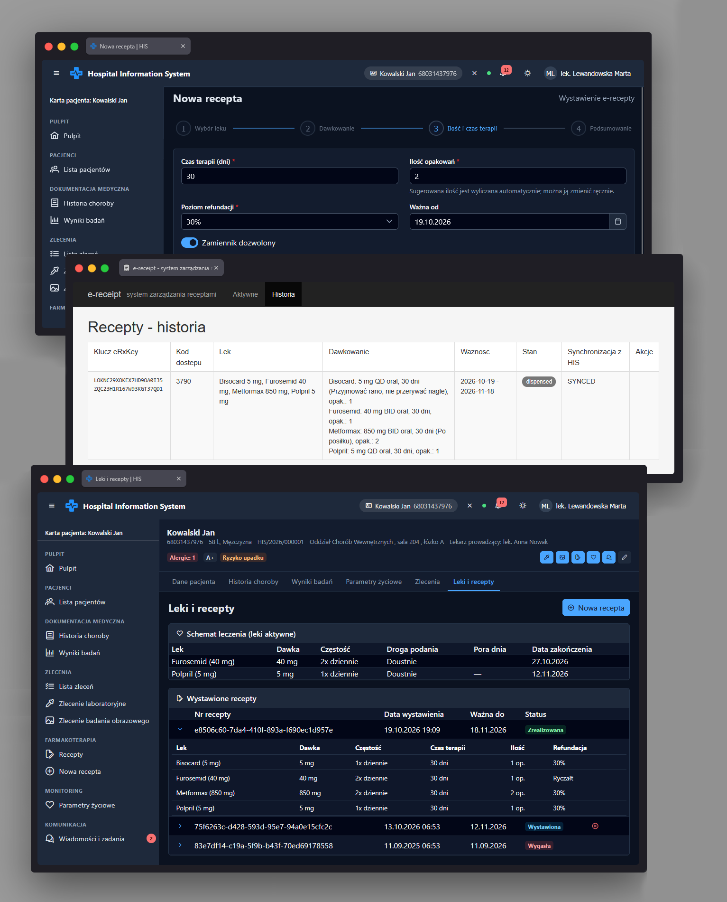
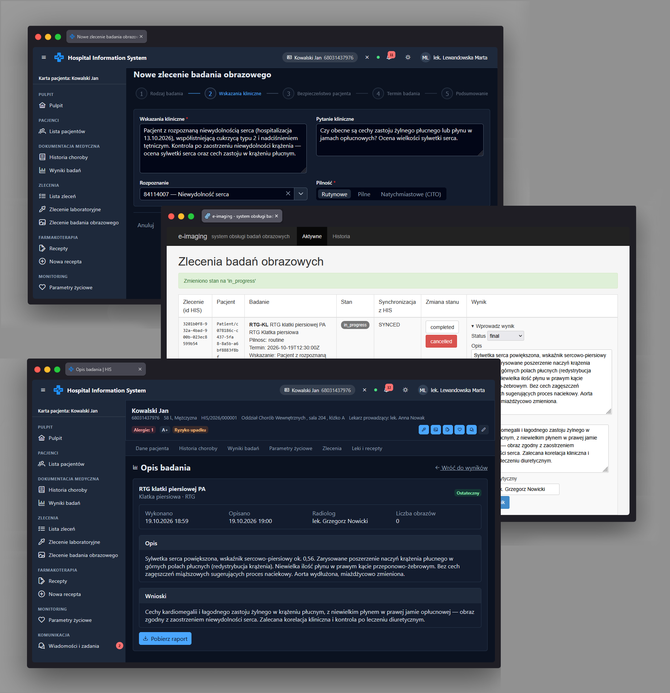
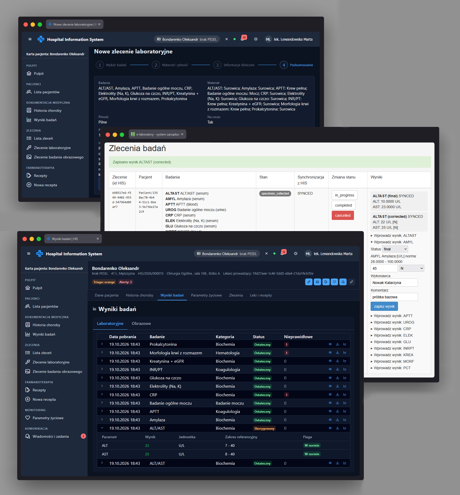

  

<h1 align="center">Hospital Information System (HIS)</h1>

  
   
  

Hospital Information System (HIS) is an enterprise-grade clinical platform built around medical-grade
information standards from the ground up. It brings patient care, diagnostics and prescribing into one
coherent workflow, speaking the same terminology and data-exchange languages used by real-world healthcare
systems - SNOMED CT, HL7 FHIR R4, and ATC drug classification. The result is a system designed to behave
like the backbone of a modern hospital's IT system.

## Enterprise standards used

- **SNOMED CT** - the world's most comprehensive clinical terminology, used for diagnoses and clinical
  indications, with ICD-10 codes derived on demand.
- **ATC (Anatomical Therapeutic Chemical)** - the WHO drug classification standard, powering the drug
  catalog and automated interaction checks.
- **HL7 FHIR R4** - the leading healthcare interoperability standard, used for every integration with
  external prescribing, laboratory and imaging systems.
- **mTLS (mutual TLS, X.509)** - mutual certificate authentication securing every service-to-service
  integration.
- **OpenAPI** - a live, always-current REST API specification.

## What HIS does

- **Patient registration & admissions** - a guided registration wizard with live duplicate detection,
  followed by admission to a ward or outpatient care.
- **Clinical documentation (EHR)** - notes, diagnoses and allergies, organized per patient and per visit.
- **Laboratory orders** - from ordering a test to tracking its progress and reviewing the result.
- **Imaging orders** - exam scheduling, safety checklists, and radiologist findings.
- **E-prescriptions** - issuing, dispensing and cancelling prescriptions, with drug interaction and
  reimbursement checks.
- **Vital signs monitoring** - continuous recording with configurable alert thresholds.
- **Clinical alerts & messaging** - critical results, vital sign anomalies and team communication in one
  place.
- **Team tasks & shift handoff** - coordinating work and patient handover between shifts and wards.
- **Role-based dashboards** - every staff role sees the information and actions relevant to their job.

## Main integrations that HIS supports

HIS is not a single closed application - it is designed to show how a hospital system connects to the
outside world. Each workflow below is a round trip across two independent systems: a doctor's action in
HIS creates an order, which is sent to an external system (a pharmacy, a radiology department or a
laboratory) over a secure, mutually-authenticated channel (**mTLS**) using the standard clinical data
format (**HL7 FHIR R4**). The external system processes the request at its own pace and reports every
status change and the final result back to HIS the same secure way, so both sides always show the current,
matching status of the same order.

### E-receipt workflow integration

The doctor issues an e-prescription in HIS. HIS sends it as a FHIR prescription record to an external
e-receipt system representing a pharmacy, which returns a redemption code the patient can use. As the
pharmacy dispenses the medication (fully, partially, or not at all), it reports the updated status back to
HIS, which is reflected live in the prescription's status for the doctor to see.

### E-imaging workflow integration

The doctor orders an imaging exam (e.g. an X-ray or CT scan) in HIS. HIS sends the order as a FHIR request
to an external e-imaging system representing a radiology department. As the exam is scheduled, performed
and reported on, the radiology system pushes each status change back to HIS, finishing with the
radiologist's findings - visible to the doctor directly in the patient's record.

### E-lab workflow integration

The doctor orders a laboratory test in HIS. HIS sends the order as a FHIR request to an external e-lab
system representing a laboratory. As the sample is collected, analyzed and the results are produced, the
lab system reports each step back to HIS, which records the final results - flagging abnormal values for
the doctor to review.

See [docs/readme/userRoles_en.md](docs/readme/userRoles_en.md) for what each role can do.

## Documentation

| Document                                                             | Contents                                                           |
| -------------------------------------------------------------------- | ------------------------------------------------------------------ |
| [docs/readme/userRoles_en.md](docs/readme/userRoles_en.md)           | Roles, what each one can do, demo accounts                         |
| [docs/readme/localDeploy_en.md](docs/readme/localDeploy_en.md)       | Ports, first-time setup, running locally (with and without Docker) |
| [docs/readme/envVariables_en.md](docs/readme/envVariables_en.md)     | Environment variables used across the project                      |
| [docs/readme/databaseSchema_en.md](docs/readme/databaseSchema_en.md) | Entity schema, relationships, initial data                         |
| [docs/readme/services_en.md](docs/readme/services_en.md)             | Services, communication between them, API documentation            |
| [docs/readme/basicWorkflows_en.md](docs/readme/basicWorkflows_en.md) | Main process flows across the system                               |

Production deployment documentation (CI/CD, server): `.github/pipeline_docs/production_deployment.md`.

---

This project references SNOMED Clinical Terms® (SNOMED CT®), a clinical terminology maintained by SNOMED
International (www.snomed.org). No SNOMED CT content is included in this repository. Users wishing to work
with real SNOMED CT data must obtain their own license via MLDS (mlds.ihtsdotools.org).
